# 乔木 X 助手 · Qiaomu X Helper

整理回复，记住常聊的人，复盘你看好的帖子，把书签带走。用 TypeSafe Jev 辅助判断，操作与记录都留在你的掌控中。

**[下载 Chrome 预览版](https://github.com/joeseesun/qiaomu-x-helper/releases/tag/v0.1.11)** · [隐私说明](PRIVACY.md) · [测试记录](docs/QA.md) · [项目研究](docs/RESEARCH.md)

当前版本 **0.1.11 Preview**，已于 2026-10-19 提交 Chrome 应用商店，当前待审核，通过后自动发布。本版默认使用 TypeSafe 官方，已配置用户继续使用原连接。默认反馈联系人、书签与编辑器的验收边界见[测试记录](docs/QA.md)，商店提交不代表审核通过。

## 界面

Vercel 风格的黑白灰界面：细边框、克制的间距、浅色与深色自动切换。以下是**示例数据**。

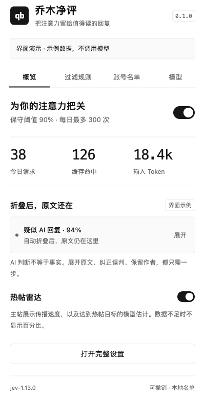 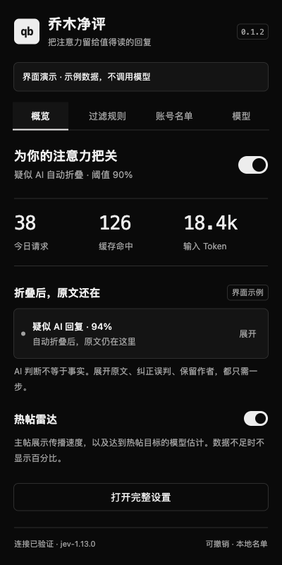

模拟会话中的折叠、保留与热帖展示（非真实账号或模型结果）：

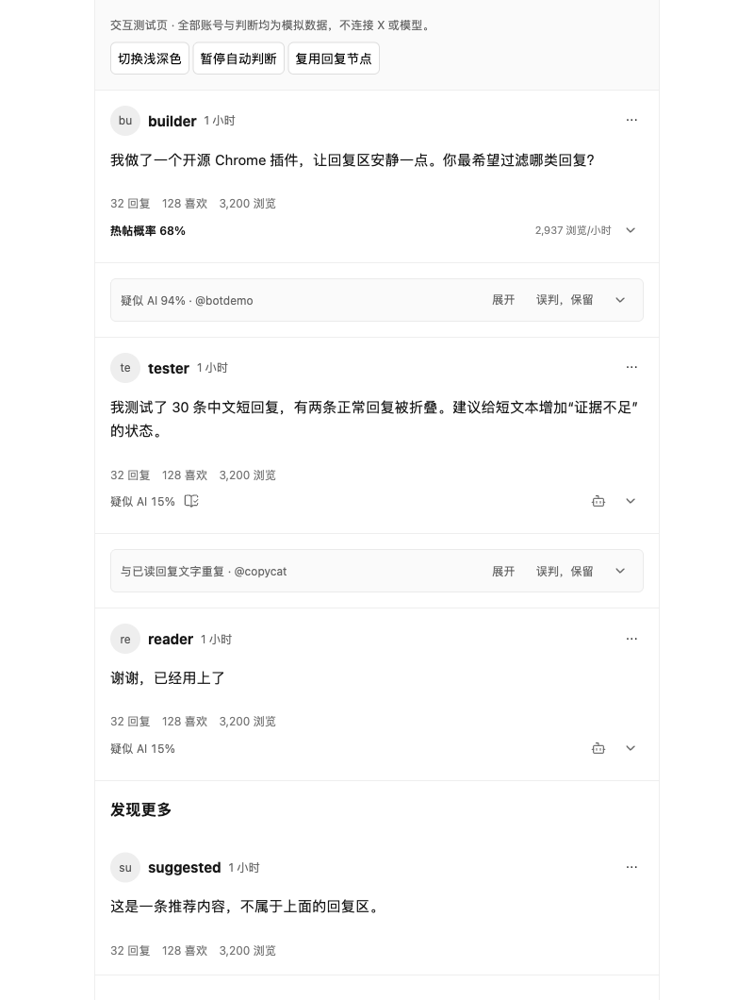

模型连接只需一次「连接并保存」，不必输入测试文本：

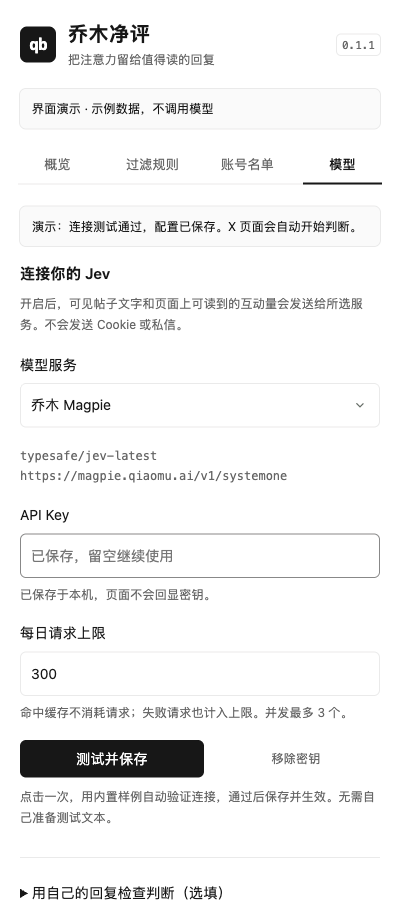

## 能做什么

| 功能 | 行为 |
| --- | --- |
| 疑似 AI 回复过滤 | 默认高于 50%，折叠原文并保留展开入口 |
| 仅标记模式 | 先观察判断结果，不自动折叠；手动屏蔽仍生效 |
| 自然语言规则 | 例如“折叠与主帖无关的空投广告” |
| 重复回复 | 折叠同一页面后出现的同文回复；短回复不去重 |
| 直接查看分数 | 回复下方显示「AI 概率：xx%」，点击下拉箭头查看详细分数和操作 |
| 值得一读 | 用书本勾选图标标出具体经验、补充信息、有内容的反对意见 |
| 误判纠正 | 保留这一条、始终保留作者、手动折叠；保留只覆盖本条，不推断作者身份 |
| 可选屏蔽 | 本地屏蔽作者；或打开 X 的屏蔽确认，由你完成最后一步 |
| 热帖雷达 | 时间后显示 Lucide 火焰与概率，悬停提示“爆款概率”，点击弹层看依据；默认预测“发布 24 小时内达到 10,000 浏览”的概率，目标可改 |
| 使用控制 | 本地缓存、默认每天 10,000 次请求（可改）、最多 3 个并发、限流冷却 |
| 账号统计 | 按人工 AI / 真人标注次数分别排序，显示昵称、账号和两类计数；一键本机屏蔽 / 保留，提供 X 主页关注或拉黑入口 |
| 原位展开 | 从正文开头展开，顶部显示“已展开”和收起按钮，保持时间线顺序 |
| 人工标记学习 | 机器人 / 真人双选，初始未标注，再点已选项可撤销；独立标注页、每页 20 条、历史不再按 40 条淘汰；每次最多 6 条参考 |
| 一键连接 | 内置样例自动测试，通过后保存，不必准备测试文字 |
| 常用 @ | 记录确认发送成功的回复对象，按登录账号隔离；头像、昵称、@账号、备注、置顶和最近互动；支持拼音 / 首字母搜索、手动添加 |
| 原生编辑器插入 | 工具栏 @ 打开联系人，搜索后按 Enter 将「昵称 @账号」插到光标处，可撤销；不会替你发帖 |
| 书签导出 | 打开 X 书签页即自动保存已加载书签，进度吸顶，暂停按账号记住；搜索正文 / 作者 / 标签 / 备注，导出全部或搜索结果为 Markdown |
| 看好追踪 | “我感觉能爆”保存当时模型概率和互动量，3 天后复盘；再次打开原帖时更新数据，没有新数据时显示待复盘 |
| 回复测试台 | 粘贴回复和主帖上下文，查看 Jev 的实际判断 |

只处理当前已加载、进入视口的帖子，不自动翻页。支持中英文回复标记；详情页会区分原帖、回复链与推荐区域；从某条回复的链接进入，也会把它识别为回复。无法确定类型时保留原文，不插入类型选择按钮。

## 设置与标注

设置分为概览、过滤、标注、账号、书签、连接、关于。过滤页可输入 1–99% 阈值，默认严格高于 50% 才折叠。「标注」按 AI / 真人筛选，每页只读 20 条；升级保留旧版现存样本，以前已被旧 40 条上限淘汰的记录无法恢复。「账号」分为「常用 @」与「标注统计」，每页 20 个。统计随改标、撤销同步更新，旧记录升级后继续计入；缺失的昵称会在再次读到对应帖子时补充。关于页提供公众号、打赏和 GitHub 反馈入口。

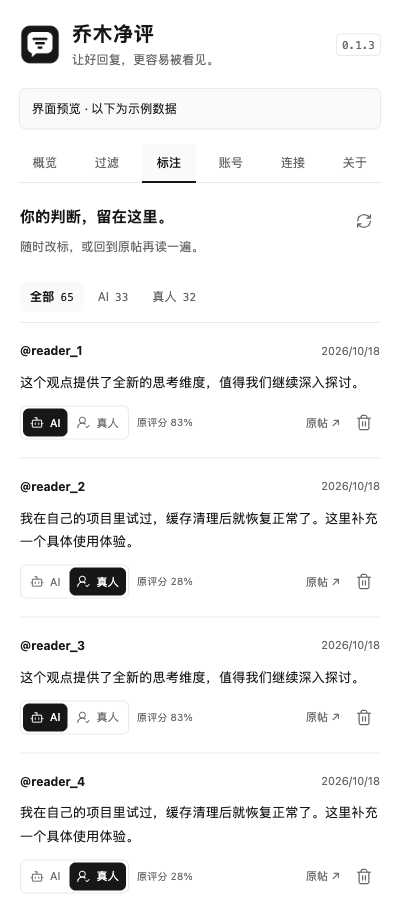 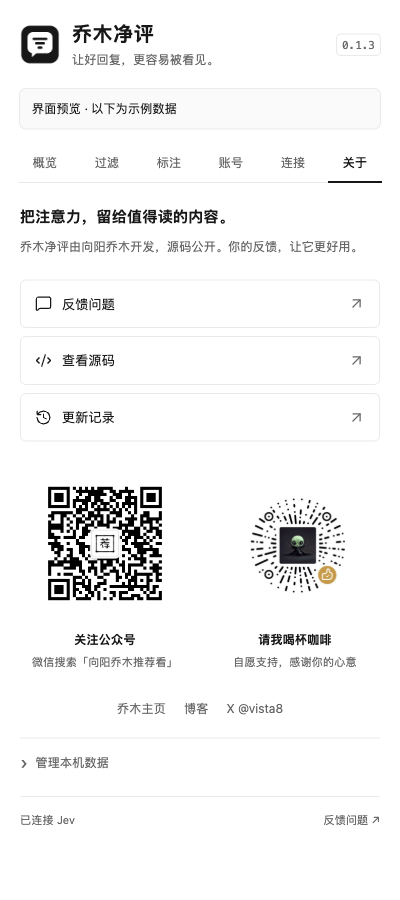

账号排序与操作（示例数据）：

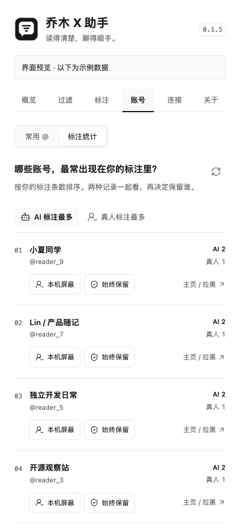

Chrome 图标采用黑白对话气泡和过滤线，提供 16 / 32 / 48 / 128 px：

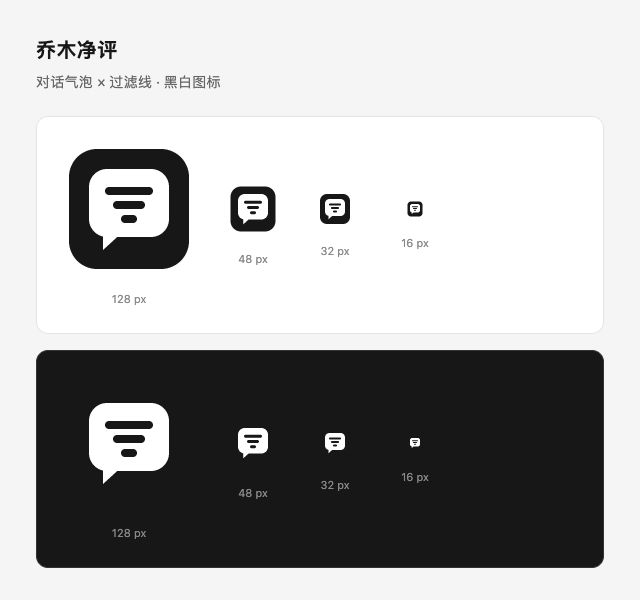

## 常用 @ 与看好追踪

- 在 X 编辑器点 **@**，搜索昵称、拼音（如 `qiaomu`）、首字母（如 `qm`）、@账号或备注。↑↓ 选择、Enter 插入，Escape 返回编辑器。按置顶与最近互动排序，插入「昵称 @账号」（无昵称时只插入 @账号），保留草稿和原生撤销。按钮与原生工具栏同色、同尺寸，跟随主题；私人备注只用于搜索，不进入正文。
- 在 **账号 → 常用 @** 手动添加、备注、置顶、复制或移除。首次打开 X 后自动识别登录账号；也可手动填自己的账号，各账号联系人相互独立。
- **自动记录从启用后开始**。只有已知回复对象、观察到成功帖子 / 回执且草稿已清空时才计入，失败、取消、自我回复不计入。无法确认时宁可漏记，不会仅凭“点了回复”收录。没有扫描历史回复；头像或昵称缺失时，读到对应帖子后补齐。
- 移除联系人后不再自动收录该账号，手动添加可恢复。联系人不用 API Key、不发送给 Jev，不改变 AI / 真人判断。头像来自页面已有的 X 图片地址，不抓取资料页。
- **我感觉能爆**保存第一次看好时的概率、模型、目标、时间和互动量，重复点击不改写原始预测。概览 → **查看我的看好追踪**集中复盘；后续只更新最近观测，支持移除。
- **3 天后的浏览量不等于第 24 小时的浏览量**。期限内观察到达标才记录“期限内达标”，没有证据就保持未知。当前没有自动抓取、到期通知、自动训练或校准。

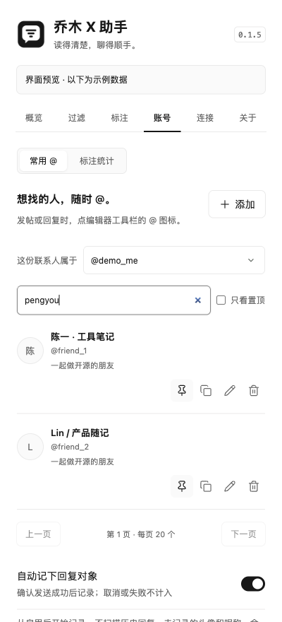 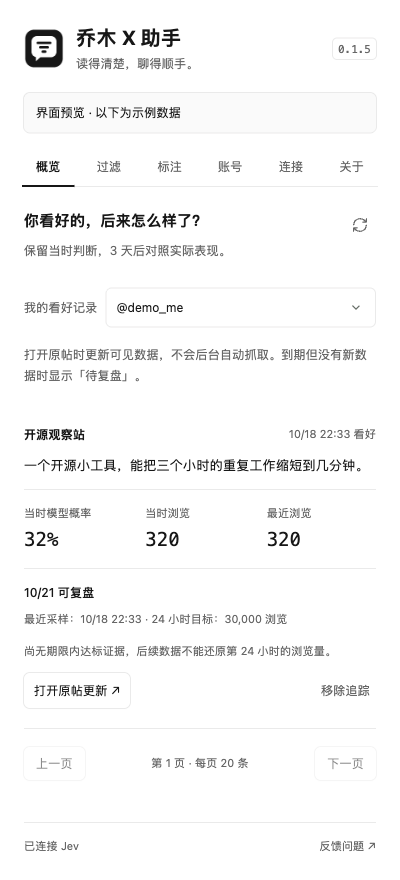

常用 @ 默认提供 **向阳乔木 @vista8**，备注为「插件作者 · 问题反馈」。可搜索账号、昵称、拼音或“反馈”，选择后沿用「昵称 @账号」插入。已有自定义资料保持不变，可编辑或移除；移除后不会自动恢复。登录 @vista8 本人时不重复添加自己。

## 书签导出

1. 打开 X 的书签页（新版在 **历史 → 书签**），插件会自动保存已加载的书签，无需先点开始。
2. 继续向下浏览，即可保存更多。顶部固定显示 **已保存 N 条**，随时可点 **暂停**；该账号的暂停选择会保留，刷新或下次打开也不会自动恢复。点 **继续保存** 可重新开启。
3. 点 **查看 / 导出**，或打开插件的 **书签** 页。可按账号查看、搜索、添加备注与标签。
4. 点 **导出 Markdown**，下载当前账号的全部本机书签；输入搜索词后，按钮变为 **导出搜索结果**，包含全部匹配条目，不限当前页。

导出包含已收集正文、作者、原帖链接、发布时间、首次收集时间、备注、标签与图片链接，适合直接放进 Obsidian。视频与引用帖通过原帖查看；媒体文件不随 Markdown 下载。未展开的长帖、收集时显示的译文都会标明。X 没有提供实际收藏时间，因此不会把首次收集时间当成收藏时间。

**采集范围以本机条数为准，不代表全部历史书签。** 不自动滚到底、不调用私有 X API。离开书签页即停止；再次进入会按该账号的选择自动保存或保持暂停。若原地切换账号但旧帖子仍在，先停止并提示刷新，避免混存。重复帖子会去重，更完整的正文可补齐，备注与标签保留。移除的是本机副本，X 的书签不变；以后再次收集可重新加入。在 X 取消收藏也不会自动删除已保存副本。

书签页跳过自动模型判断，收集和导出不需要 API Key、不调用 Jev。数据留在此浏览器的 IndexedDB，按 @账号隔离；列表按每页 20 条读取。单次 Markdown 超过 40 MB 时提示搜索后分批导出，不会悄悄截断。

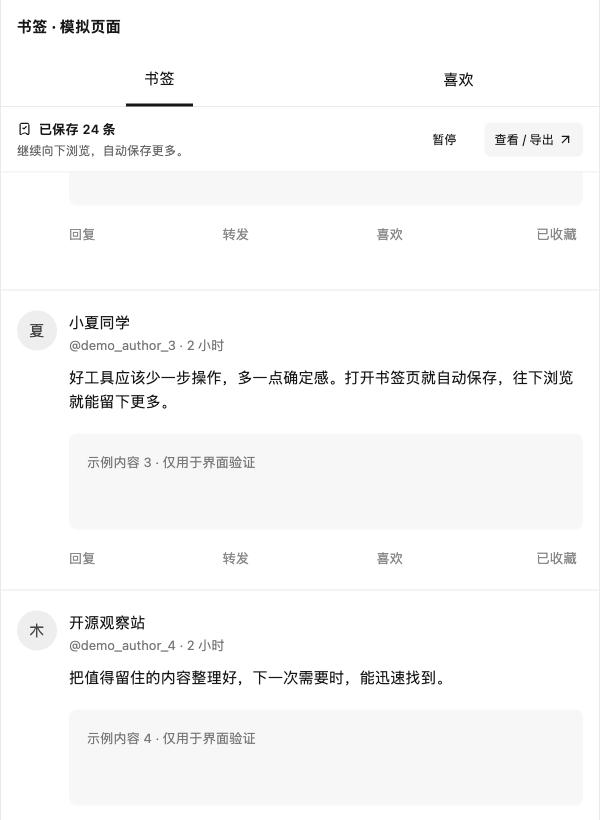

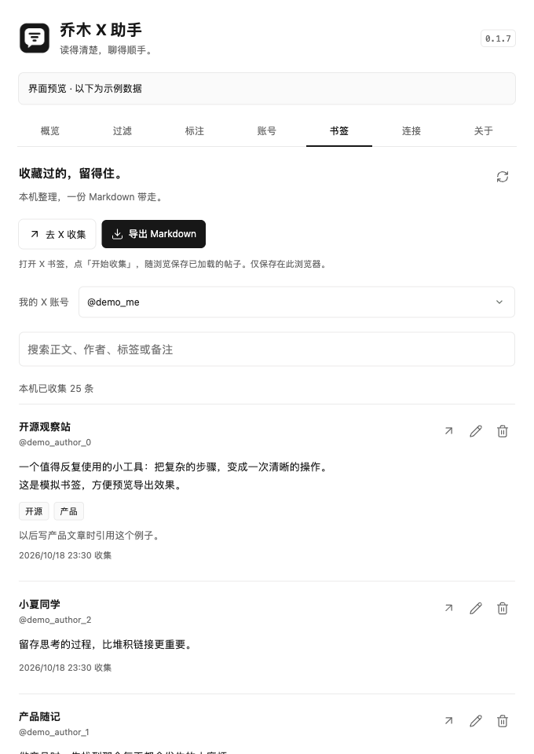

## 安装

需要 Chrome 120 或更新版本。

1. 在 [Release](https://github.com/joeseesun/qiaomu-x-helper/releases/tag/v0.1.11) 下载 `qiaomu-x-helper-0.1.11-chrome.zip` 并解压到固定目录。
2. 打开 `chrome://extensions`，开启右上角「开发者模式」。
3. 点击「加载已解压的扩展程序」，选择**包含 `manifest.json` 的文件夹**。
4. 在 Chrome 扩展菜单固定「乔木 X 助手」，打开「连接」。
5. 选择服务平台，输入该平台的 API Key，点击「连接并保存」，允许 Chrome 访问对应模型服务。
6. 插件自动发送内置样例，显示“已连接，密钥已保存”后即生效，无需额外测试。首次安装或升级后刷新已打开的 X 页面。

升级时在原安装目录覆盖新版本，回到 `chrome://extensions` 点击扩展的刷新按钮，再刷新 X。保持安装路径不变，避免产生新的扩展身份。

### 模型接入

| 服务 | 默认模型名 | Base URL | 获取 API Key |
| --- | --- | --- | --- |
| 乔木 Magpie | `typesafe/jev-latest` | `https://magpie.qiaomu.ai/v1` | [乔木控制台](https://magpie.qiaomu.ai/) |
| TypeSafe 官方 | `jev-latest` | `https://api.typesafe.ai/v1` | [注册与控制台](https://console.typesafe.ai/) |
| OpenRouter | `typesafe/jev-1.14` | `https://openrouter.ai/api` | [登录 / 创建密钥](https://openrouter.ai/settings/keys) |
| Vercel AI Gateway | `typesafe-ai/jev` | `https://ai-gateway.vercel.sh/typesafe` | [Gateway 密钥入口](https://vercel.com/d?title=Get+API+key&to=%2F%5Bteam%5D%2F~%2Fai-gateway%2Fquick-start%3FshowCreateKeyModal%3Dauto%26utm_source%3Dgateway-model-page%26utm_campaign%3Dai-gateway-models) |
| 自定义服务 | 手动填写 | 在高级设置填写 | 向服务商获取 |

模型名可以编辑；Base URL 与接口选择放在「高级设置」。OpenRouter 使用 `/alpha/decisions`，其余预设使用 `/v1/systemone`，都发送 `state + questions` 并读取 Noul 概率。自定义服务须兼容其中一种决策接口，普通 `chat/completions` 服务不能直接接入。支持 HTTPS，以及本机 `localhost` / `127.0.0.1` 的 HTTP 服务；实际请求地址会显示在高级设置中。

选平台后有对应的注册/密钥入口。服务额度与费用由平台决定，不承诺免费。密钥保存后显示「已保存」和遮罩，点眼睛可临时查看，点「更换密钥」编辑。换服务商或地址必须提供对应密钥，连接失败保留原配置。不会自动读取其他工具的密钥，也不会自动把旧密钥发给新地址。每日请求上限单独保存，不触发模型测试。

预设依据 [TypeSafe 官方说明](https://docs.typesafe.ai/introduction/quickstart)、[OpenRouter 接入说明](https://openrouter.ai/blog/insights/what-is-jev/) 和 [Vercel TypeSafe 接口](https://vercel.com/docs/ai-gateway/sdks-and-apis/typesafe)，核对日期 2026-10-18。当前只有乔木 Magpie 完成真实密钥请求，其他预设完成协议适配与自动测试，用户连接时会做实际验证。

## 建议这样测试

1. **查看默认行为**：默认是「疑似 AI 回复」模式，高于 50% 自动折叠，恰好 50% 保留。概览会显示当前是否自动折叠；若希望暂时观察，可主动切到「仅标记」。
2. **验证折叠**：切回「疑似 AI 回复」，保留默认 50% 阈值。符合条件的回复应折叠，点击「展开」应从正文开头原位展开，出现“已展开”提示；列表顺序不变。继续往下滚，新出现的回复也应进入判断。
3. **验证人工学习**：在回复下点击机器人图标应立即折叠，点击旁边的真人图标应保留；再次点击已选图标撤销。滚动到页面中部操作，阅读位置应保持，其他帖子不重建。在独立的「标注」页筛选、翻页、改标或删除记录。
4. **验证误判处理**：在下拉面板点击「只保留此条」，刷新后同条回复应保留；「始终保留作者」应让该作者绕过模型过滤。
5. **验证屏蔽**：先测试可撤销的「本地屏蔽作者」。只有确实想拉黑时才点「在 X 拉黑…」，核对 X 自己的账号确认弹窗。
6. **验证热帖**：选择发布 10 分钟至 24 小时、可见浏览量的主帖。点击时间后的火焰图标与概率，查看「模型估计 · 未校准」并核对目标与时间；缺数据的帖子应显示“数据不足”。
7. **验证常用 @**：先手动添加一个账号，再在 X 草稿中插入并撤销，不必为了测试发帖。自动记录需由你正常回复一次后确认，取消或发送失败应不计入。
8. **验证追踪**：点“我感觉能爆”，到概览的追踪页核对当时概率和数据；当前没有后续数据时不应显示“预测成功”。
9. **验证恢复**：关闭总开关，所有原文应恢复；拔掉网络时应保留原文并显示重试入口。

也可在「账号」切换 AI / 真人排序，核对改标前后计数。这里的关注 / 拉黑入口打开 X 主页，需要你在 X 完成；本机屏蔽和始终保留立即生效。

简短、致谢、调侃都是正常交流。本版已移除「低信息量」判断，不再请求、显示这类分数，也不据此折叠；旧版的「按信息量」模式升级后转为「只显示结果」。可选的「值得一读」只做正向提示，没有图标不代表低质量。

不需要为了测试而真的拉黑任何人。X 更新可能改变菜单和 DOM，若屏蔽入口无法匹配，会提示你使用原帖菜单。

## 判断的边界

**疑似 AI 分数不是作者身份证明，也不是识别准确率。** 短回复、引用 AI 文本、非母语表达都可能误判。默认不会根据单条回复自动拉黑账号；只对文字做判断，不识别图片或视频内容。

**热帖百分比是尚未校准的模型估计。** 输入仅包括页面可见文字、发布时间、浏览量及互动量；没有完整曝光轨迹或粉丝基线。当前平均浏览/小时不是瞬时增长速度。发布时间不足 10 分钟、缺少浏览量或已超过 24 小时时，不输出概率；在窗口内达到目标则显示“已达到热帖目标”。

短回复、致谢和日常交流本身都不是 AI 或低质量的理由。人工标签用于 few-shot 个性化参考，不是重新训练 Jev，也不保证识别准确率提升。标注历史存于 IndexedDB，不再按条数淘汰（仍受浏览器存储空间限制）；每次从最近 40 条候选中按回复与主帖上下文相关性选取最多 3 条 AI、3 条真人样本；相同文本去重，标签冲突的重复文本和待判断文本本身不参与。样本随请求发送给你选择的服务。标记或删除样本会使旧判断缓存失效。

标注是你对这条文字的判断；上方分数保留标注前的模型估计，没有历史分数则显示「—」，不会由人工标签伪造 0% / 100%。旧版“非 AI”标签直接兼容；“只保留此条”是显示偏好，不会自动变成真人训练样本。标记只刷新对应回复，折叠条上下各留 8px。

要验证个性化效果，应按重复文本分组留出独立样本，对比无样本 / 有样本的真人误折叠率、AI 漏检率及样本数；评估样本不能出现在请求示例中。当前尚未验证准确率改善。默认 AI 阈值改为 50%（严格大于），旧版 90% 默认值随升级迁移，其他自定义值保留；引流和自定义规则仍要求至少 90%。默认限额升至每日 10,000 次，旧版 300 默认值随升级迁移，其他自定义值保留；3,000 的旧硬上限已移除，服务商限额仍由服务商决定。

白名单优先于模型和本地屏蔽。服务错误、限流、响应缺字段时保留原文，不把错误当成“确定是 AI”。未加载的回复、无法识别结构的帖子和纯媒体内容不会被完整覆盖。

## 开发

Node.js 22.13+（CI 使用 Node.js 24），打包需要 `zip`。

```bash
npm ci
npm test
npm run build
npm run package
```

加载 `dist/chrome` 即可。ZIP 输出到 `artifacts/`，源码、测试夹具、开发脚本和任何密钥均不进入安装包。

```bash
npm run preview
```

访问 `http://127.0.0.1:4178/dist/chrome/ui.html?demo=1&popup=1` 预览设置；访问 `http://127.0.0.1:4178/test/fixtures/conversation.html` 测试模拟会话。两者均使用明确标识的模拟数据，不调用模型，不连接 X。

可选的 `npm run test:live` 适用于已配置 `qiaomu-llm` 的本机开发环境：从既有注册表读取 Magpie 密钥，仅在进程内调用真实模型，执行 6 条构造样例。`python3 scripts/live.py --post` 执行一个热帖样例。`python3 scripts/live.py --connection` 实测一键连接及带人工样本的后续判断。它们会产生少量 API 用量，不是准确率基准，也不在 CI 中执行。

代码分为 DOM 提取、策略/协议、后台队列与存储、页面渲染、设置 UI；只有后台向模型服务发请求。没有远程脚本、后台爬虫或私有 X API。

## 后续设计（未实现）

- **值得回复的提及**：未处理 / 已回复 / 稍后队列，给出推荐理由，打开原生回复框。
- **本机兴趣匹配**：罗盘入口，感兴趣 / 不感兴趣与原因，帮助插件个性化；不会训练 X 推荐算法。
- **预测回测**：积累期限内快照、人工标签及独立评测后，再评估概率校准。

来源、许可核对与具体交互见 [项目研究](docs/RESEARCH.md)。

## 参考与许可证

本项目独立实现，MIT 开源。Lucide 图标遵循其 ISC / MIT 许可，拼音搜索使用 MIT 许可的 pinyin-pro；完整许可随安装包附带。研究了 [x-focus](https://github.com/fxzer/x-focus)、[hide-the-annoying](https://github.com/turkerdev/hide-the-annoying)、[go-jev](https://github.com/mattn/go-jev) 等项目的交互与接入思路，未复制其实现。完整来源及取舍见 [项目研究](docs/RESEARCH.md)。

Jev 是 TypeSafe 的模型服务；本仓库开源的是扩展，不代表模型权重开源。我们与 X、Vercel、TypeSafe 没有隶属或背书关系。
