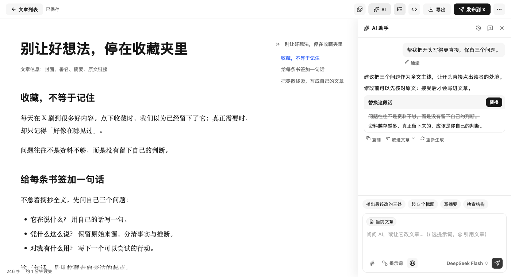
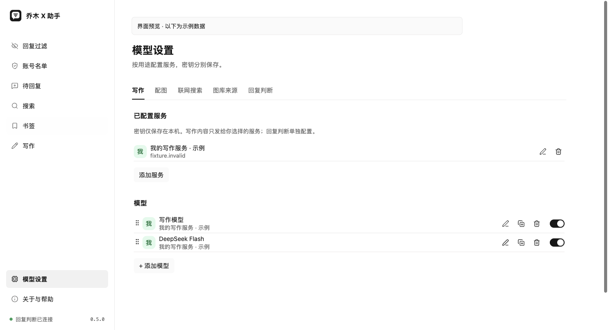
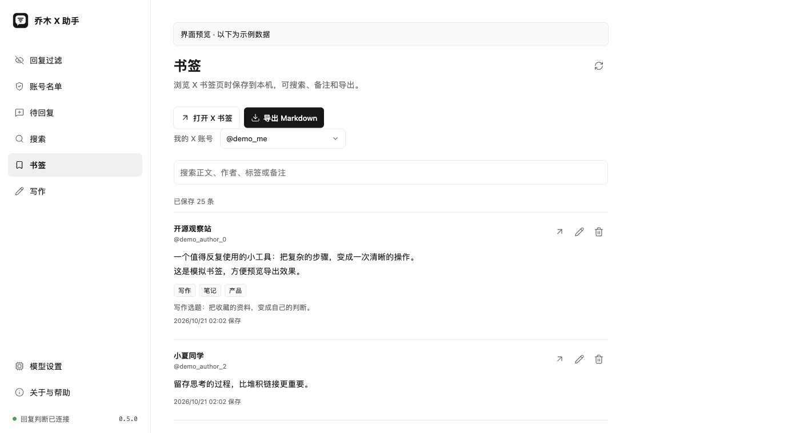

# 乔木 X 助手 · Qiaomu X Helper

**中文** | [English](#english)

**少刷一点噪音，多写一点自己的想法。**

给经常在 X 阅读、收藏和创作的人：整理回复、找回书签，在一处查资料、写文章、配图，再直接送进 X 草稿。

Read with focus. Keep what matters. Turn your ideas into an X article.

**[下载 Chrome 安装包](https://github.com/joeseesun/qiaomu-x-helper/releases/tag/v0.5.0)** · [三步安装](#三步开始) · [使用前必读](#按需连接不用一次配完) · [商店状态](docs/store/SUBMISSION.md)


MIT 开源 · 数据默认保存在本机 · 发帖由你确认 · **0.5.0 Preview**

## 别让好内容，只剩一个收藏按钮

刷到一条好帖，想以后再看，却再也找不到；打开回复区，被重复内容打断；终于准备写文章，又得在编辑器、搜索和图库之间来回切换。

X Helper 把这些常用步骤放到顺手的位置。你可以只用无需密钥的书签、搜索和编辑器，也可以接入自己的 AI 服务，逐步搭起写作工作台。

| 你遇到的问题 | X Helper 怎么帮你 |
|---|---|
| 回复太杂，读不下去 | 按自己的规则折叠回复，随时展开、纠正或始终保留某位作者 |
| 收藏了，但忘了为什么 | 给书签加备注和标签，搜索正文与作者，导出 Markdown 带走 |
| 好回复不能现在写 | 加入待回复，在本机慢慢写草稿，再填入对应 X 回复框 |
| 文章卡在开头或结构 | AI 看当前文章和选区，提出修改卡片；点接受后才改正文 |
| 写着写着要查事实、找图 | 在写作对话中联网查资料、打开来源、找图片或生成配图 |
| 图片散落在聊天里 | 独立图库统一收纳，查看后台生图任务，挑选后插入文章 |
| 模型配置到处找 | 写作、配图、联网搜索、图库来源和回复判断分别管理 |
| 排好版后又要复制一遍 | 直接点「发布到 X」，把文章与配图送入 X 原生草稿 |

## 三步开始

1. **下载安装包**：打开 [v0.5.0 Release](https://github.com/joeseesun/qiaomu-x-helper/releases/tag/v0.5.0)，下载 `qiaomu-x-helper-0.5.0-chrome.zip` 并解压。
2. **加载扩展**：在 Chrome 地址栏输入 `chrome://extensions`，开启「开发者模式」，点「加载已解压的扩展程序」，选择包含 `manifest.json` 的解压目录。
3. **先做一件有用的事**：打开 X 书签页保存已加载内容，或点扩展里的「写作」，开始写第一篇文章。

**不需要先装 PKG，也不需要先填 API Key。** AI 与外部图库是按需连接的可选功能。升级时保留原目录、替换文件后重新加载；先导出重要文章与配置。

当前 GitHub 提供预览安装包。Chrome 商店的上传、审核和公开上架是独立状态，见[提交记录](docs/store/SUBMISSION.md)，不要把发布说明当作已经上架的证明。

## 从想法，到文章



**正文始终由你掌控。** 所见即所得与 Markdown 可切换，大纲跟着文章走；代码、表格、公式和 Mermaid 可以一起写。文章自动保存在本机，支持回收站、Markdown 和含图片 ZIP 导入导出。

AI 可以理解当前文章、选区和引用的资料，帮你起标题、写摘要、润色、扩写或检查结构。建议以可接受的修改卡片呈现；聊天记录可以重开，文章和输入区各自滚动。

**X Helper 的主按钮就是「发布到 X」。** 不需要再选平台。点击后准备文章与图片、打开 X 文章编辑器并写入草稿；最后的检查与发布留给你。需要账号本身拥有 X Articles 权限。

## 查资料，找图，继续写


- **联网搜索**：在对话里搜索与读取公开网页，查看工具进度和可点击来源；也能随时关闭联网。
- **图片搜索**：连接 Unsplash 或兼容代理，搜索、查看来源、下载并插入图片。
- **独立图库**：上传图片、访问主动选定的本地文件夹，管理生成结果；重命名、删除或批量处理。
- **后台配图**：图片请求由后台页面承接。关闭侧栏后任务可继续，重开可找回进度；浏览器关闭或系统中断后的任务不会自动重新计费，需自行检查和重试。

联网、素材和图片生成使用你配置的第三方服务，可能产生费用；图片的许可和用途仍需你核对。

## 模型一次配好，写作时随手切换



先连接服务，再选模型；支持获取模型列表、搜索、手动添加、编辑、删除、启用和默认模型。写作时可直接切换模型与支持的思考档位。服务端点改变时会清除原密钥，防止把旧服务的凭据发往新地址。

配图单独选择服务与多个模型；联网搜索和图库来源也有自己的设置。配置备份默认不包含 API Key，账号登录会话始终不导出；恢复前预览并合并，本机已有配置优先。

## 读过的好内容，留得住



打开 X 书签页，会保存当前已加载的书签，支持暂停。备注、标签、原帖链接和正文一起导出 Markdown，适合带到自己的笔记库。书签按登录账号隔离，移除本机副本不会取消 X 收藏。

高级搜索把关键词、作者、日期和互动条件组成可复用查询，直接在 X 打开。待回复保留原文与本机草稿；常用 @ 支持昵称、账号、备注、拼音和首字母搜索。它们不会替你发送回复。

## 按需连接，不用一次配完

| 功能 | 需要什么 |
|---|---|
| 文章编辑、书签、搜索条件、待回复、常用 @、本地词汇规则 | 扩展即可，无 API Key |
| AI 写作 | 自备文字服务密钥，或使用支持的账号登录入口 |
| AI 回复判断 | 独立的 Jev typed decision 服务配置；不是普通聊天接口 |
| 联网查资料 | DeepSeek Search / Fetch 或 Brave Search 凭据 |
| 云端配图 | 图片服务凭据与可用模型；支持兼容接口及自部署即梦服务 |
| Unsplash 图片搜索 | Unsplash Access Key 或兼容代理 |
| 本机 Codex 生图 | **可选**：已登录的 Codex、包含生图协议的乔木助手、当前扩展来源注册；见[兼容说明](docs/LOCAL-HELPER.md) |
| 写入 X 文章草稿 | 已登录 X，且账号拥有文章功能 |

DeepSeek 写作默认使用 `deepseek-flash`，不自动回退到 Pro。文字、搜索、配图、Jev 的凭据分别配置，不自动从 Clipper 或其他服务复制。

## 数据与判断的边界

文章、书签和配置默认留在本浏览器，不使用 Chrome Sync。你发起 AI 操作时，所需的正文、选区、指令或图片会发往所选服务；搜索词与网页地址会发给搜索服务。第三方的收费和留存政策由各服务决定。

回复判断是有可能出错的参考，**不能证明一个人是 AI 或机器人**。未知或无效结果保留原文，不自动拉黑账号。仅处理已加载内容，不扫描全部历史、不自动无限滚动。可选社区订阅与贡献默认关闭。

更多信息：[隐私说明](PRIVACY.md) · [本地助手](docs/LOCAL-HELPER.md) · [安全反馈](SECURITY.md) · [详细行为与研究](docs/RESEARCH.md)

## 开发与验证

Node.js 22.13+（CI 使用 24），打包需要 `zip`。

```bash
npm ci
npm test
npm run build
npm run package
```

产物在 `dist/chrome` 与 `artifacts/`。`npm run preview` 提供使用示例数据的页面，开发与预览脚本不进入安装包。

本轮验证包括 **159 项 Node + 269 项 Vitest**、生产构建、真实浏览器中的生产 UI 夹具，以及一次真实 `deepseek/deepseek-flash` 流式写作调用。截图来自实际生产界面，文章、账号和服务响应使用明确标注的示例数据；概念主视觉由内置生图生成。

浏览器安全策略阻止访问已安装扩展内部页，本轮未重验真实 X 草稿写入；搜索、Unsplash、云端/本机生图与各供应商账号登录未逐一实测。自动测试与页面夹具不能替代这些外部验收。详见[验证记录](docs/QA.md)与[Clipper 功能对照](docs/WRITER-PARITY.md)。

## 开源、反馈与来源

由 [向阳乔木](https://x.com/vista8) 维护，欢迎通过 [Issues](https://github.com/joeseesun/qiaomu-x-helper/issues) 提交问题或功能建议；截图前请遮盖密钥和私人内容。

[MIT License](LICENSE)。写作、模型与图库模块改编自 [Qiaomu Clipper](https://github.com/joeseesun/qiaomu-clipper)，X 草稿引擎包含 xPoster 的 MIT 代码，完整说明见 [Third-party notices](THIRD_PARTY_NOTICES.md)。本项目与 X 及模型服务商没有隶属或官方背书关系。

---

<a id="english"></a>

## English

**Spend less time in the noise. Publish more of your own thinking.**

Qiaomu X Helper is a Chrome extension for people who read, save, reply and write on X. Keep useful bookmarks, draft thoughtful replies, write long articles with AI assistance, search for sources, manage images, and send an article directly to an X draft.

### Try it

1. Download and unzip the Chrome ZIP from [v0.5.0 Preview](https://github.com/joeseesun/qiaomu-x-helper/releases/tag/v0.5.0).
2. Open `chrome://extensions`, enable Developer mode, and choose **Load unpacked**. Select the folder containing `manifest.json`.
3. Open X bookmarks or the extension’s writing workspace. These features work without an API key or native helper.

AI writing, search, image generation and reply classification require your own respective services and may incur provider fees. The native helper is optional and only required for local Codex image generation; not every released helper PKG supports this protocol. X article export requires access to X Articles. The extension fills a draft; **you review and publish it yourself**.

### What you get

- Local Markdown/rich-text editor, outline, autosave, trash and Markdown/image ZIP import/export.
- Contextual AI chat, selected-text editing and explicit acceptance of suggested changes.
- Web search with source links, image search, a persistent gallery and background image jobs.
- Provider/model management, reasoning options and configuration backup with keys excluded by default.
- Reversible reply filtering, account overrides, reusable searches, bookmark Markdown export, reply drafts and searchable contacts.

Data is stored locally by default. Requested AI/search operations send relevant content to your configured service. There is no browser-history collection, automatic final publication or automatic account blocking. AI authorship estimates can be wrong and are not identity evidence.

This release passed 159 Node and 269 Vitest tests, production build and browser fixtures. A real DeepSeek Flash request returned streamed text. Installed extension pages were blocked by browser tooling; live X article insertion and all search/image/OAuth providers were not revalidated. Product screenshots use real UI with synthetic demonstration data; campaign artwork is AI-generated. See [QA](docs/QA.md), [Privacy](PRIVACY.md) and the independent [store submission status](docs/store/SUBMISSION.md).

MIT licensed. Maintained by [Qiaomu](https://github.com/joeseesun). [Report a bug](https://github.com/joeseesun/qiaomu-x-helper/issues).
